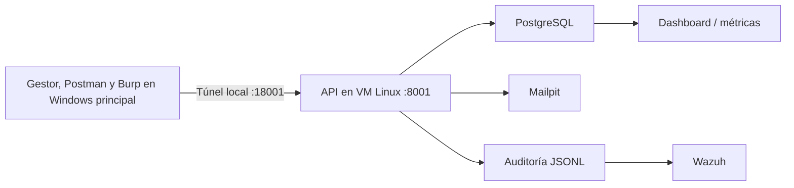

# Informe de evaluación técnica — Red Team

**Tarea 1 — Gestor de contraseñas. Estado: preliminar. Actualizado: 31/10/2026.**

Este informe reúne los resultados y recomendaciones según la [plantilla oficial](../../../plantilla/informe-red-team.md). Las fichas RT-P contienen el procedimiento y la evidencia de **esas mismas pruebas**. Los códigos RT-H son hallazgos; mencionarlos aquí no crea pruebas adicionales.

## Control del documento

| Campo | Valor |
|---|---|
| Código / versión | RT-T1-2026 / 0.3 — preliminar |
| Cátedra / docente | Seguridad de la Información / docente pendiente. |
| Equipo Red Team | Integrantes y firmas pendientes. |
| Sistema | Gestor de contraseñas: cliente, control central y auditoría. |
| Período documentado | Desde el 19/10/2026; fechas locales America/Montevideo y registros originales UTC. |
| Versión evaluada | Commit, artefacto congelado y comprobación de integridad pendientes. |
| Referencia de requisitos | [LETRA.md de Tarea 1](../../LETRA.md), sección 7; la copia `consigna.md` de esta carpeta corresponde a Tarea 2 y no reemplaza esa fuente. |

### Mapeo normativo de referencia

Según la plantilla: MCU 5.0 Detectar/Responder; BCU GSI, evaluación de controles; ISO 27001 A.5.24–A.5.28, incidentes; ISO 27005/31000, riesgo; COBIT MEA02, evaluación de controles. Los resultados aportan evidencia técnica parcial; no acreditan cumplimiento general ni madurez MCU.

## 1. Resumen ejecutivo

Se documentaron **trece pruebas ejecutadas**: P01–P05 y P07–P14. P06 solo tiene preparación de cuenta; sus intentos no se ejecutaron. H04 proviene de revisión de código y no tiene demostración temporal. El número de pruebas no equivale al porcentaje de hallazgos requerido para la preentrega.

En el servicio se observó lectura de metadatos de auditoría sin autenticación (**H01, Media 5.3**) y duplicación de auditoría y correos al reenviar un evento firmado (**H02, Baja 3.7 condicionada**). En el cliente se reprodujo la reconfiguración TOTP incompleta (**H03, severidad pendiente**) y se aceptó una maestra de un carácter (**P10, severidad pendiente**). P01 generó registros y alerta Wazuh. No se demostró acceso a contraseñas reales, exposición a Internet, ejecución de código ni caída del servicio.

## 2. Alcance y reglas de compromiso

Para P01–P07, P09 y P10 se trabajó desde Windows principal con el cliente, Postman o Burp según la prueba, la API FastAPI, PostgreSQL, Wazuh, Mailpit y el código del laboratorio. La API utiliza `192.168.77.10:8001` en la VM Linux; `127.0.0.1:18001` es el extremo del túnel en Windows principal hacia el mismo servicio. Para P08 se usó Zenmap/Nmap en la VM Windows por la red interna. Configuración y cambios de preparación: [entorno del laboratorio](01-entorno-laboratorio.md). Acuerdos pendientes: [alcance preliminar](00-alcance-preliminar.md).

Las pruebas utilizaron datos ficticios e intentos acotados. Se excluyeron exfiltración real, carga masiva, DoS destructivo y borrado masivo. No se corrigió el código evaluado.

**RT-05 — revisión documental:** el Blue Team [declara explícitamente](RT-05-revision-documental-tls.md) que la entrega de laboratorio no implementa TLS en cliente → API y que acepta el riesgo residual R05. El Red Team **no ejecutó** un ataque man-in-the-middle ni una prueba de certificados. Esta revisión no se cuenta entre las pruebas ejecutadas ni como hallazgo nuevo.

Falta confirmar autorización de objetivos, técnicas y ventana, contactos, límites de carga y procedimiento de interrupción. La documentación previa indica ventana 28/10–09/11/2026, preentrega 28/10 y cierre 09/11: confirmar su aplicación a Tarea 1 y el encuadre de las actividades anteriores, conservando sus fechas reales.

## 3. Metodología

Se revisaron arquitectura, rutas, código y el historial local de Git; se ejecutaron casos acotados y se contrastaron respuestas con PostgreSQL, JSONL, Wazuh y Mailpit. Se conservaron resultados y hashes SHA-256. P08 agrega un escaneo de tres puertos desde la VM Windows; P09 una comparación exploratoria de tiempos con Burp y P11 una revisión de secretos/configuración del repositorio. No se documentaron escaneo sistemático ni post-explotación.

Herramientas utilizadas: Postman, Burp Suite Community, scripts Python/HTTP, consultas PostgreSQL, registros Wazuh, Mailpit, Nmap/Zenmap, sqlmap, Swaks y SHA-256. Revisar la adecuación de Postman al requisito de herramientas open source. La trazabilidad formal a PTES, OWASP WSTG o NIST SP 800-115 está pendiente; no se declara su ejecución completa.

| Caso | Resultado resumido | Interpretación |
|---|---|---|
| [P01](RT-P01-intentos-maestra.md) | Cinco intentos incorrectos registrados; alerta Wazuh. | Detección observada, sin bloqueo automático acreditado. |
| [P02](RT-P02-integridad-eventos.md) | Campo alterado sin renovar firma, marcado inválido. | Control de integridad observado; sin cambio de bóveda demostrado. |
| [P03](RT-P03-replay.md) | Dos reenvíos idénticos causaron registros y correos duplicados. | H02. |
| [P04](RT-P04-acceso-sin-autenticacion.md) | Auditoría sin token respondió 200; alertas respondió 401 en Burp. | H01. La repetición con Burp es evidencia adicional del mismo hallazgo. |
| [P05](RT-P05-reconfiguracion-totp.md) | Se informó apertura sin TOTP tras reconfiguración incompleta; captura final parcial. | H03. |
| [P06](postman/RT-P06-GUIA.md) | Cuenta preparada; intentos no ejecutados. | Pendiente; no cuenta como prueba ejecutada. |
| [P07](RT-P07-inactividad-boveda.md) | Bóveda vacía abierta después de 11 minutos. | Observación; severidad pendiente. |
| [P08](RT-P08-escaneo-acotado-puertos.md) | Puertos 3000, 8001 y 8025 abiertos desde VM Windows. | Reconocimiento; no vulnerabilidad por sí solo. |
| [P09](RT-P09-tiempo-login.md) | Respuestas 401 iguales y tiempos superpuestos. | Inconclusa; no confirma enumeración. |
| [P10](RT-P10-maestra-corta.md) | Bóveda ficticia reabierta con maestra de un carácter. | Debilidad de política; severidad pendiente. |
| [P11](RT-P11-revision-repositorio.md) | Revisión de archivos versionados e historial local: sin secreto operativo confirmado; tres JWS vencidos presentes en evidencias locales sin versionar. | RT-11 abordado con límite; sanear antes de publicar. |
| [P12](RT-P12-error-maestra-sin-filtracion.md) | Errores de maestra, copia inexistente, transporte incorrecto y TOTP inválido sin exposición observada de secretos. | RT-10 cerrado para esos cuatro caminos; otros errores no evaluados. |
| [P13](RT-P13-sqlmap-login.md) | sqlmap no identificó inyección SQL en `email` de `POST /api/users/login` bajo parámetros acotados. | Resultado negativo limitado a ese parámetro y configuración; no descarta otras inyecciones. |
| [P14](RT-P14-correo-mailpit.md) | Swaks envió un mensaje ficticio que Mailpit aceptó y mostró en su bandeja. | RT-04 parcial y sin vulnerabilidad confirmada: el desarrollo usa Mailpit, sin servidor de correo real ni dominio público para evaluar relay o SPF/DKIM. |

Los códigos P identifican pruebas y H hallazgos. H04 se documentó solo por análisis estático. **RT-03 queda cubierto por P04/H01**, que demostró acceso sin sesión a metadatos de auditoría del control central; P13 agrega la comprobación negativa de un vector de inyección SQL. Esto no acredita elevación de privilegios, acceso a contraseñas de bóveda ni una evaluación exhaustiva de inyecciones. El cruce formal con los demás objetivos de la [letra de Tarea 1](../../LETRA.md) sigue pendiente.

## 4. Inventario de hallazgos

El [registro de vulnerabilidades](gestion-vulnerabilidades.md) conserva las causas, condiciones, puntajes disponibles y recomendaciones. Este informe sintetiza los resultados:

| Hallazgo | Evidencia y límite | Estado |
|---|---|---|
| H01 | [P04](RT-P04-acceso-sin-autenticacion.md): metadatos de auditoría accesibles sin sesión; no expuso contraseñas de bóveda. | Abierto, Media 5.3. |
| H02 | [P03](RT-P03-replay.md): duplicados; requiere mensaje firmado vigente, cuya obtención por tercero no se demostró. | Abierto, Baja 3.7 condicionada. |
| H03 | [P05](RT-P05-reconfiguracion-totp.md): requiere acceso previo a bóveda abierta; maestra aún necesaria; captura final parcial. | Abierto, severidad pendiente. |
| H04 | [Revisión de código](RT-H04-sesion-sin-vencimiento.md): no se probó duración ni robo de token; nuevo login reemplaza el anterior. | Análisis estático, severidad pendiente. |

P07 y P10 no tienen ID H ni CVSS asignado. No hay corrección ni retest documentados.

## 5. Detalle de hallazgos

La reproducción, el impacto, los límites y las recomendaciones de cada hallazgo constan en el [registro de vulnerabilidades](gestion-vulnerabilidades.md) y en las fichas enlazadas arriba. Se evita repetir aquí el procedimiento de cada RT-P.

## 6. Mapeo a MITRE ATT&CK

Relación analítica con ATT&CK Enterprise revisada el 23/10/2026. Describe comportamientos, incluidos intentos detectados; no determina éxito ni severidad.

| Caso / hallazgo | Táctica | Técnica | Justificación |
|---|---|---|---|
| P01 | Credential Access — TA0006 | [T1110.001 — Password Guessing](https://attack.mitre.org/techniques/T1110/001/) | Cinco intentos incorrectos: simulación limitada de adivinación; detección verificada. |
| P02 | Impact — TA0040 | [T1565 — Data Manipulation](https://attack.mitre.org/techniques/T1565/) | Alteración simulada de `sistema`, detectada por la firma; sin aceptación como auténtico en esa validación. |
| P03 / H02 | Impact — TA0040 | T1565 — Data Manipulation | Inserción de duplicados que distorsionan el registro de actividad; contenido firmado sin cambios. |
| P04 / H01 | Collection — TA0009 | [T1213 — Data from Information Repositories](https://attack.mitre.org/techniques/T1213/) | Relación contextual con lectura de auditoría almacenada mediante API; sin acceso directo a PostgreSQL ni extracción masiva. |

Se usa T1565 general: no se demostró interceptación de tráfico ni edición directa de datos en reposo para precisar una subtécnica. El replay de P03 no acredita robo de sesión o reutilización de credenciales de autenticación. Evidencias y límites: [Gestión de vulnerabilidades](gestion-vulnerabilidades.md) y documentos P01–P04.

## 7. Evaluación de la respuesta del Blue Team

El [registro de incidentes de prueba](registro-incidentes.md) contiene el seguimiento de eventos, impacto, detección, respuesta y cierre. Aquí se resume la eficacia observada de los controles.

| Caso | Eficacia observada | Límite o pendiente |
|---|---|---|
| P01 | Wazuh correlacionó cinco intentos en dos minutos: regla 100101, nivel 10. | No acredita bloqueo automático; apertura final y demora de interfaz pendientes. |
| P02 | Copia alterada marcada inválida; original válido. | No acredita el comportamiento posterior de los consumidores de eventos inválidos. |
| H01 | Usuarios exige autenticación; auditoría/KPI permitieron lectura sin ella. | Contradice la protección de acceso al panel/dashboard declarada en `docs/09-Gestion-Accesos.md`, según revisión previa. Contraste formal con SoA pendiente. |
| H02 | La firma se valida, pero no evita efectos duplicados. | Deduplicación no verificada. |

La detección automática está documentada; la respuesta humana del Blue Team, responsables, plazos y retests están pendientes. El contraste por función MCU se presenta a continuación. Es una evaluación técnica parcial, no una calificación del perfil Avanzado ni un porcentaje de madurez.

### 7.1 Eficacia observada por función MCU 5.0

La [letra de Tarea 1](../../LETRA.md) pide evaluar en la presentación final la eficacia de los controles del Blue Team frente a cada función MCU. Esta tabla relaciona únicamente lo probado con la función correspondiente. Las referencias del Blue Team sirven para contrastar afirmaciones de la solución; no se asigna un resultado a todos los controles de su planilla MCU ni se extrapola al cumplimiento general.

| Función | Prueba y evidencia | Eficacia observada y contraste | Límite / pendiente |
|---|---|---|---|
| **Gobernar (GV)** | No hubo una prueba de gobierno, responsables o aprobación de riesgos. | **No evaluada.** | Contrastar hallazgos con políticas, responsables, excepciones y aceptación formal del riesgo junto al Blue Team. |
| **Identificar (ID)** | Se revisaron la app, el backend y la documentación. [P10](RT-P10-maestra-corta.md) identificó una debilidad de la bóveda; [P03](RT-P03-replay.md) y [P04](RT-P04-acceso-sin-autenticacion.md) identificaron H02/H01 en la API; [P08](RT-P08-escaneo-acotado-puertos.md) confirmó tres puertos abiertos desde la VM Windows. | **Evaluación parcial de la función:** se registraron debilidades y servicios observados. El escaneo de puertos no es un hallazgo por sí mismo. | Revisar con el Blue Team si su inventario de activos y análisis de riesgos reflejan estos resultados; la revisión del proyecto no equivale a comprobar todos los controles MCU de Identificar. |
| **Proteger (PR)** | [P02](RT-P02-integridad-eventos.md): alteración de `sistema` detectada. [P04/H01](RT-P04-acceso-sin-autenticacion.md): lectura de auditoría sin token. [P05/H03](RT-P05-reconfiguracion-totp.md): al abandonar la reconfiguración se pudo abrir sin TOTP. [P07](RT-P07-inactividad-boveda.md): bóveda vacía seguía abierta a los 11 minutos. [P10](RT-P10-maestra-corta.md): se aceptó una maestra de un carácter. | **Mixta.** La comprobación de firma funcionó para P02. El acceso a auditoría sin autenticación contradice la protección de acceso al control central descrita en [Gestión de accesos del Blue Team](../09-Gestion-Accesos.md); P05 muestra una brecha en el mantenimiento del segundo factor. P07 señala ausencia de cierre durante el intervalo observado. P10 evidencia una política de maestra insuficiente. | La lectura sin token no expuso contraseñas ni prueba exposición a Internet. P05 requiere acceso previo a la bóveda abierta y mantiene la contraseña maestra; su captura final es parcial. P07 no probó acceso a credenciales. El impacto de P10 depende de que un tercero obtenga el archivo cifrado; no se demostró descifrado externo. |
| **Detectar (DE)** | [P01](RT-P01-intentos-maestra.md): cinco intentos registrados y alerta Wazuh 100101. [P02](RT-P02-integridad-eventos.md): firma inválida identificada. [P03/H02](RT-P03-replay.md): eventos y correos duplicados. | **Mixta.** La correlación de fuerza bruta y la marca de firma inválida funcionaron. El replay aceptado afecta la fiabilidad de los registros y notificaciones que alimentan el monitoreo, frente a la trazabilidad descrita por [Monitoreo del Blue Team](../07-Monitoreo-Logs-SIEM.md). | No se demostró bloqueo automático por Wazuh, ni una alerta específica de replay, ni el tratamiento posterior de todos los eventos inválidos. |
| **Responder (RS)** | P01 documentó una alerta automática; [registro de incidentes de prueba](registro-incidentes.md). | **Respuesta humana no evaluada.** Una alerta no acredita contención, escalamiento ni cierre. | Registrar recepción, decisión y acciones del Blue Team ante cada hallazgo, con fecha y responsable. |
| **Recuperar (RC)** | Ninguna prueba Red Team de restauración o continuidad. | **No evaluada.** | Verificar RPO/RTO y restauración con el Blue Team; sus [planes de continuidad](../06-Plan-Continuidad.md) no sustituyen una comprobación Red Team. |

P06 solo tiene preparación de cuenta y no aporta resultado a ninguna función. H04 procede de revisión de código y todavía carece de prueba temporal; no se cuenta como eficacia demostrada. La asociación a funciones es analítica y requiere contraste con el Excel de controles MCU y la SoA de la versión efectivamente evaluada antes del informe final. No se calcula una nota de madurez MCU con esta cobertura parcial.

## 8. Lecciones aprendidas y recomendaciones

La firma de un evento permite detectar alteraciones, pero no evita que un mismo mensaje válido se procese varias veces. Una alerta automática tampoco demuestra respuesta humana. Se recomienda:

1. Exigir autenticación y permisos para auditoría/KPI; repetir P04.
2. Añadir identificador único firmado e idempotencia; repetir P03 con un evento nuevo.
3. Conservar el TOTP anterior hasta confirmar el reemplazo; repetir P05.
4. Definir longitud mínima de maestra al crear y cambiar; repetir P10.
5. Acordar tiempos de sesión e inactividad y luego medir H04/P07.
6. Registrar responsable, respuesta del Blue Team y retest por hallazgo.

## 9. Anexos

### A. Bitácora

[Planilla diaria](04-bitacora-planilla.xlsx). Completar responsables nominales, firmas y horas UTC cuando estén respaldadas. Las fechas de actividad son locales; algunos eventos nocturnos del 21/10 corresponden al 22/10 UTC.

### B. Fichas y evidencias

La tabla de la sección 3 enlaza cada ficha RT-P. Las [carpetas de evidencias](evidencias/) usan los mismos códigos y conservan capturas o registros y `SHA256SUMS.txt`. P04 incluye evidencias de Postman y Burp en `evidencias/RT-P04/`; Burp verifica nuevamente H01. En P10, las capturas 01–03 son un intento descartado; las 04–05 sustentan el resultado. Las colecciones de `postman/` ayudan a reproducir; su preparación no acredita ejecución.

La [revisión documental RT-05](RT-05-revision-documental-tls.md) enlaza los pasajes originales del Blue Team y conserva un extracto con hashes. No tiene captura de ataque porque no se realizó una prueba MITM.

### C. Estado consolidado al 31/10/2026

Trece pruebas ejecutadas: P01–P05 y P07–P14. P06, preparada pero no ejecutada. Dos hallazgos del servicio con CVSS asignado (H01 Media 5.3; H02 Baja 3.7 condicionada), H03 reproducido manualmente con severidad pendiente, H04 de análisis estático sin prueba temporal, y P07/P10 sin valoración. P12 no confirmó una filtración; P14 solo confirmó la recepción de un correo ficticio por Mailpit. Este recuento no acredita el 70 % de hallazgos de la preentrega: no existe inventario completo que permita calcular ese porcentaje. No hay correcciones verificadas.

### D. Pendientes de entrega

- Confirmar alcance, versión congelada, participantes, ventana y cobertura de los objetivos de la consigna.
- Completar valoración de H03/H04 y P07/P10, con sus límites.
- Completar responsables, firmas, respuesta del Blue Team, contraste MCU/SoA y retests.
- Convertir el informe a DOCX según la plantilla para la entrega final.

La recuperación y RPO/RTO no fueron verificados. La documentación de pruebas anteriores al 28/10 conserva sus fechas reales; su aceptación dentro de la evaluación formal sigue pendiente de confirmación.
