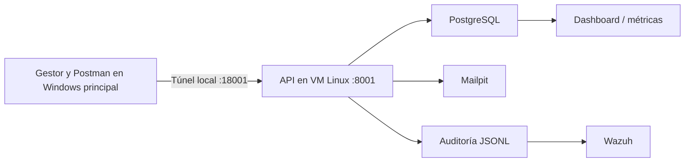

# Informe de evaluación técnica — Red Team

La copia publicada de las evidencias contiene firmas JWS redactadas; véase [Nota sobre la publicación](NOTA-PUBLICACION.md).

## Prueba RT-P10 — 29/10/2026

Se realizó [RT-P10, contraseña maestra de un carácter](RT-P10-maestra-corta.md) en una bóveda ficticia vacía. El usuario informó que creó la bóveda con `a` y aportó capturas de un carácter oculto en el campo y de la misma bóveda abierta tras cerrarla. El código solo rechaza una maestra vacía. Es una debilidad de la política de contraseña maestra, con impacto condicionado a que alguien obtenga el archivo cifrado. No se demostró descifrado fuera de la app ni acceso a credenciales reales; severidad pendiente. Las primeras tres capturas de la carpeta corresponden a un intento descartado por error de tecla y no sustentan el resultado.

## Prueba exploratoria RT-P09 — 28/10/2026

Se realizó [RT-P09, comparación de tiempos de login](RT-P09-tiempo-login.md) con correos ficticios y contraseñas incorrectas desde Burp Community en el Windows principal. Ambas variantes devolvieron 401 con el mismo mensaje. Los tiempos válidos visibles fueron 83 y 1012 ms para correo inexistente, y 1086 y 1032 ms para la cuenta ficticia existente. La superposición de muestras impide confirmar enumeración por tiempo. Se registra como **prueba inconclusa, sin nuevo hallazgo ni severidad**. Capturas y hashes: `evidencias/RT-P09/`.

## Comprobación adicional de RT-P04 — 28/10/2026

Se reprodujo [RT-P04 / RT-H01](RT-P04-acceso-sin-autenticacion.md) desde Burp Suite Community en el Windows principal, por el túnel local al backend Linux. `GET /api/events/?limit=1` sin cabecera de autorización ni cookies visibles devolvió **200** y un registro de metadatos. Como control, Burp interceptó `GET /api/alerts/?limit=1` y, tras reenviarlo, la historia HTTP mostró **401**. El control de alertas funciona; el acceso de lectura a auditoría sigue abierto sin sesión. Las capturas originales y hashes están en `evidencias/RT-P04/`. Esta comparación refuerza H01 y no agrega otra vulnerabilidad. KPI y el control de usuarios aún carecen de capturas manuales comparables.

## Actualización de reconocimiento — 28/10/2026

Se incorporó [RT-P08, enumeración acotada de puertos](RT-P08-escaneo-acotado-puertos.md): desde la VM Windows se comprobaron abiertos los puertos TCP 3000, 8001 y 8025 de la VM Linux. Es un resultado de reconocimiento, no otro hallazgo de vulnerabilidad. La captura muestra una fecha anterior porque el reloj de la VM Windows está desactualizado; el límite queda explicado en la ficha. P08 es la primera prueba documentada desde esa VM y no cambia la procedencia de P01–P07.

## Estado documental para la preentrega — 27/10/2026

**Procedencia corregida:** las pruebas P01–P07 se realizaron desde el Windows principal del usuario. El gestor y Postman fueron locales; cuando una prueba involucró la API, sus datos llegaron por el túnel `127.0.0.1:18001` al backend, PostgreSQL y SIEM de la VM Linux. La VM Windows preparada no se usó como cliente de esas ejecuciones; P08, añadida después, sí se realizó desde ella. Véanse [entorno real y preparación](01-entorno-laboratorio.md) y las fichas de prueba. P01–P07 se registraron con sus fechas originales, anteriores a la ventana 28/10–09/11 indicada en la letra; falta confirmar su aceptación para la evaluación formal.

La preentrega del 28/10 exige un informe preliminar con al menos el 70 % de los hallazgos detectados y su reproducción, según [LETRA.md](../../LETRA.md). El índice de pruebas al corte actual incluye P01–P05 y P07. P06 tiene una cuenta ficticia preparada, pero **sus cinco intentos incorrectos no se ejecutaron** y por ello no se cuenta como prueba concluida. H01 y H02 están reproducidos; H03 tiene reproducción manual con el límite de captura señalado en P05; H04 es un hallazgo de código pendiente de comprobación temporal. P07 es una observación de 11 minutos con bóveda vacía, aún sin puntaje. No se suman estos pendientes a los conteos de severidad del corte del 23/10.

La captura de Postman de [P04](RT-P04-acceso-sin-autenticacion.md) muestra un GET de auditoría sin autenticación que devolvió 200. La comprobación posterior en Burp añadió otra captura de auditoría 200 y un control comparativo de alertas 401. La consulta de KPI y el control de usuarios conservan por ahora solo el resultado de la verificación técnica inicial. Para cerrar la preentrega faltan valoración y repro formal de H03/H04, decisión de clasificación de P07, responsables y firmas de bitácora, y capturas manuales de KPI y usuarios. No se atribuyen resultados a P06.

## Observación adicional — 25/10/2026

Se documentó [RT-P07 — bóveda abierta tras 11 minutos sin interacción](RT-P07-inactividad-boveda.md). Dos capturas del usuario muestran la misma bóveda ficticia abierta a las 22:39 y 22:50. La bóveda estaba vacía: se observó la ausencia de cierre automático durante ese intervalo, pero no se probó acceso a credenciales. Severidad y retest pendientes; no se incorpora al conteo de hallazgos puntuados de los cortes anteriores.

## Incorporación documental — 25/10/2026

Se registra [RT-H04 — Token del panel sin vencimiento temporal](RT-H04-sesion-sin-vencimiento.md), identificado mediante revisión de código. La autenticación compara el hash almacenado sin comprobar antigüedad; un nuevo login sí reemplaza el token. Su reutilización requeriría obtener un token válido y conectividad a la API. No se ejecutó una demostración temporal ni se asignó severidad. Esta incorporación añade un hallazgo de análisis estático, no otra prueba ejecutada ni otro hallazgo confirmado en vivo. Los conteos de los cortes anteriores conservan su fecha.

## Actualización de resultados — 24/10/2026

Se incorpora **RT-P05 / RT-H03: reconfiguración incompleta desactiva TOTP de la bóveda**, reproducida manualmente por el usuario en una bóveda ficticia. Antes de reconfigurar, la app rechazó la apertura sin código; después de generar otro TOTP y cerrar sin confirmarlo, el usuario comunicó apertura sin segundo factor y aportó captura de la bóveda abierta. Requiere acceso previo a la bóveda abierta y la contraseña sigue siendo necesaria. La variante del backend no se ejecutó.

[Procedimiento, causa y límites](RT-P05-reconfiguracion-totp.md); capturas y hashes en `evidencias/RT-P05/`. CVSS, MITRE, incidente, riesgo y respuesta del Blue Team pendientes. Se recomienda mantener el factor anterior hasta confirmar el nuevo y exigir reautenticación para modificar factores. No hay corrección ni retest.

**Conteo actualizado:** cinco casos y tres hallazgos registrados: dos del servicio y uno de la app. H03 tiene severidad pendiente; los conteos de cuatro casos y dos hallazgos del cuerpo siguiente corresponden al corte anterior del 23/10. No se modifica su valoración de H01/H02.

**Tarea 1 — Gestor de contraseñas. Estado: preliminar.** Estructura basada en [la plantilla oficial](../../../plantilla/informe-red-team.md). El cuerpo siguiente conserva el corte del 23/10/2026; las incorporaciones posteriores constan arriba y en sus fichas.

## Control del documento

| Campo | Valor |
|---|---|
| Código / versión | RT-T1-2026 / 0.2 — preliminar |
| Cátedra / docente | Seguridad de la Información / docente pendiente. |
| Equipo Red Team | Integrantes y firmas pendientes. |
| Sistema | Gestor de contraseñas: cliente, control central y auditoría. |
| Período documentado | Desde el 19/10/2026; fechas locales America/Montevideo y registros originales UTC. |
| Versión evaluada | Commit, artefacto congelado y comprobación de integridad pendientes. |
| Referencia de requisitos | [LETRA.md de Tarea 1](../../LETRA.md), sección 7; la copia `consigna.md` de esta carpeta corresponde a Tarea 2 y no reemplaza esa fuente. |

### Mapeo normativo de referencia

Según la plantilla: MCU 5.0 Detectar/Responder; BCU GSI, evaluación de controles; ISO 27001 A.5.24–A.5.28, incidentes; ISO 27005/31000, riesgo; COBIT MEA02, evaluación de controles. Los resultados aportan evidencia técnica parcial; no acreditan cumplimiento general ni madurez MCU.

## 1. Resumen ejecutivo

Se evaluaron intentos fallidos de apertura de la bóveda, alteración y reenvío de eventos firmados y lectura de auditoría sin autenticación. Se observaron dos controles efectivos en los aspectos probados y dos hallazgos en el servicio.

La detección de intentos repetidos y la comprobación de integridad funcionaron. Las debilidades observadas afectan la confidencialidad de metadatos y la confiabilidad de la auditoría. No se demostró acceso a contraseñas de la bóveda, ejecución de código ni exposición a Internet. La valoración base es H01: Media (5.3) y H02: Baja (3.7, condicionada a la obtención de un mensaje vigente); la cobertura parcial impide concluir sobre la seguridad integral del sistema.

## 2. Alcance y reglas de compromiso

Para P01–P07 se trabajó con el cliente en Windows principal, Postman en ese equipo, la API FastAPI, PostgreSQL, Wazuh, Mailpit y el código del laboratorio. La API utiliza `192.168.77.10:8001` en la VM Linux; `127.0.0.1:18001` es el extremo del túnel en Windows principal hacia el mismo servicio. Para P08 se usó Zenmap/Nmap en la VM Windows por la red interna. Configuración y cambios de preparación: [entorno del laboratorio](01-entorno-laboratorio.md). Acuerdos pendientes: [alcance preliminar](00-alcance-preliminar.md).

Las pruebas utilizaron datos ficticios e intentos acotados. Se excluyeron exfiltración real, carga masiva, DoS destructivo y borrado masivo. No se corrigió el código evaluado.

Falta confirmar autorización de objetivos, técnicas y ventana, contactos, límites de carga y procedimiento de interrupción. La documentación previa indica ventana 28/10–09/11/2026, preentrega 28/10 y cierre 09/11: confirmar su aplicación a Tarea 1 y el encuadre de las actividades anteriores, conservando sus fechas reales.

## 3. Metodología

Se revisaron arquitectura, rutas y código; se ejecutaron casos acotados y se contrastaron respuestas con PostgreSQL, JSONL, Wazuh y Mailpit. Se conservaron resultados y hashes SHA-256. P08 agrega un escaneo de solo tres puertos desde la VM Windows; no se documentaron escaneo sistemático ni post-explotación.

Herramientas utilizadas: Postman, scripts Python/HTTP, consultas PostgreSQL, registros Wazuh, Mailpit, Nmap/Zenmap y SHA-256. Revisar la adecuación de Postman al requisito de herramientas open source. La trazabilidad formal a PTES, OWASP WSTG o NIST SP 800-115 está pendiente; no se declara su ejecución completa.

| Caso | Control evaluado | Resultado |
|---|---|---|
| P01 | Detección de intentos fallidos de maestra | Auditoría y alerta verificadas; sin acceso indebido demostrado. |
| P02 | Integridad de eventos firmados | Alteración detectada como firma inválida. |
| P03 | Unicidad de eventos | Replay con duplicación de auditoría y correos: H02. |
| P04 | Autenticación de consultas | Lectura inicial de auditoría/KPI sin token: H01. |

Los IDs P identifican pruebas y H identifican hallazgos. El cruce con los objetivos de la letra de Tarea 1 queda pendiente de disponer de esa fuente; no se reutiliza la numeración de Tarea 2.

## 4. Inventario de hallazgos

El [registro de vulnerabilidades](gestion-vulnerabilidades.md) contiene el inventario, puntajes y vectores CVSS, estados, fechas y responsables: RT-H01 y RT-H02 confirmados inicialmente en el servicio. P01 y P02 registran controles efectivos en lo probado.

## 5. Detalle de hallazgos

Las causas, condiciones, reproducción, impactos, evidencias y recomendaciones de RT-H01 y RT-H02 se documentan en las fichas de [Gestión de vulnerabilidades](gestion-vulnerabilidades.md). Los procedimientos por prueba se conservan en P01–P04, enlazados en el anexo B.

## 6. Mapeo a MITRE ATT&CK

Relación analítica con ATT&CK Enterprise revisada el 23/10/2026. Describe comportamientos, incluidos intentos detectados; no determina éxito ni severidad.

| Caso / hallazgo | Táctica | Técnica | Justificación |
|---|---|---|---|
| P01 | Credential Access — TA0006 | [T1110.001 — Password Guessing](https://attack.mitre.org/techniques/T1110/001/) | Cinco intentos incorrectos: simulación limitada de adivinación; detección verificada. |
| P02 | Impact — TA0040 | [T1565 — Data Manipulation](https://attack.mitre.org/techniques/T1565/) | Alteración simulada de `sistema`, detectada por la firma; sin aceptación como auténtico en esa validación. |
| P03 / H02 | Impact — TA0040 | T1565 — Data Manipulation | Inserción de duplicados que distorsionan el registro de actividad; contenido firmado sin cambios. |
| P04 / H01 | Collection — TA0009 | [T1213 — Data from Information Repositories](https://attack.mitre.org/techniques/T1213/) | Relación contextual con lectura de auditoría almacenada mediante API; sin acceso directo a PostgreSQL ni extracción masiva. |

Se usa T1565 general: no se demostró interceptación de tráfico ni edición directa de datos en reposo para precisar una subtécnica. El replay de P03 no acredita robo de sesión o reutilización de credenciales de autenticación. Evidencias y límites: [Gestión de vulnerabilidades](gestion-vulnerabilidades.md) y documentos P01–P04.

## 7. Evaluación de la respuesta del Blue Team

El [registro de incidentes de prueba](registro-incidentes.md) contiene el seguimiento de eventos, impacto, detección, respuesta y cierre. Aquí se resume la eficacia observada de los controles.

| Caso | Eficacia observada | Límite o pendiente |
|---|---|---|
| P01 | Wazuh correlacionó cinco intentos en dos minutos: regla 100101, nivel 10. | No acredita bloqueo automático; apertura final y demora de interfaz pendientes. |
| P02 | Copia alterada marcada inválida; original válido. | No acredita el comportamiento posterior de los consumidores de eventos inválidos. |
| H01 | Usuarios exige autenticación; auditoría/KPI permitieron lectura sin ella. | Contradice la protección de acceso al panel/dashboard declarada en `docs/09-Gestion-Accesos.md`, según revisión previa. Contraste formal con SoA pendiente. |
| H02 | La firma se valida, pero no evita efectos duplicados. | Deduplicación no verificada. |

La detección automática está documentada; la respuesta humana del Blue Team, responsables, plazos y retests están pendientes. El contraste por función MCU se presenta a continuación. Es una evaluación técnica parcial, no una calificación del perfil Avanzado ni un porcentaje de madurez.

### 7.1 Eficacia observada por función MCU 5.0

La [letra de Tarea 1](../../LETRA.md) pide evaluar en la presentación final la eficacia de los controles del Blue Team frente a cada función MCU. Esta tabla relaciona únicamente lo probado con la función correspondiente. Las referencias del Blue Team sirven para contrastar afirmaciones de la solución; no se asigna un resultado a todos los controles de su planilla MCU ni se extrapola al cumplimiento general.

| Función | Prueba y evidencia | Eficacia observada y contraste | Límite / pendiente |
|---|---|---|---|
| **Gobernar (GV)** | No hubo una prueba de gobierno, responsables o aprobación de riesgos. | **No evaluada.** | Contrastar hallazgos con políticas, responsables, excepciones y aceptación formal del riesgo junto al Blue Team. |
| **Identificar (ID)** | P03 y P04 identificaron la API de auditoría como activo afectado; [H01/H02](gestion-vulnerabilidades.md) están inventariados. [P08](RT-P08-escaneo-acotado-puertos.md) verificó tres puertos TCP abiertos desde la VM Windows. | **Cobertura parcial del inventario de vulnerabilidades y servicios**, sin validar el inventario completo de activos ni el análisis de riesgos del Blue Team. P08 no es un hallazgo por sí mismo. | Vincular los activos y riesgos reales del Blue Team; no inferir madurez de ID desde dos hallazgos y tres puertos. |
| **Proteger (PR)** | [P02](RT-P02-integridad-eventos.md): alteración de `sistema` detectada. [P04/H01](RT-P04-acceso-sin-autenticacion.md): lectura de auditoría sin token. [P05/H03](RT-P05-reconfiguracion-totp.md): al abandonar la reconfiguración se pudo abrir sin TOTP. [P07](RT-P07-inactividad-boveda.md): bóveda vacía seguía abierta a los 11 minutos. | **Mixta.** La comprobación de firma funcionó para P02. El acceso a auditoría sin autenticación contradice la protección de acceso al control central descrita en [Gestión de accesos del Blue Team](../09-Gestion-Accesos.md); P05 muestra una brecha en el mantenimiento del segundo factor. P07 señala ausencia de cierre durante el intervalo observado. | La lectura sin token no expuso contraseñas ni prueba exposición a Internet. P05 requiere acceso previo a la bóveda abierta y mantiene la contraseña maestra; su captura final es parcial. P07 no probó acceso a credenciales. |
| **Detectar (DE)** | [P01](RT-P01-intentos-maestra.md): cinco intentos registrados y alerta Wazuh 100101. [P02](RT-P02-integridad-eventos.md): firma inválida identificada. [P03/H02](RT-P03-replay.md): eventos y correos duplicados. | **Mixta.** La correlación de fuerza bruta y la marca de firma inválida funcionaron. El replay aceptado afecta la fiabilidad de los registros y notificaciones que alimentan el monitoreo, frente a la trazabilidad descrita por [Monitoreo del Blue Team](../07-Monitoreo-Logs-SIEM.md). | No se demostró bloqueo automático por Wazuh, ni una alerta específica de replay, ni el tratamiento posterior de todos los eventos inválidos. |
| **Responder (RS)** | P01 documentó una alerta automática; [registro de incidentes de prueba](registro-incidentes.md). | **Respuesta humana no evaluada.** Una alerta no acredita contención, escalamiento ni cierre. | Registrar recepción, decisión y acciones del Blue Team ante cada hallazgo, con fecha y responsable. |
| **Recuperar (RC)** | Ninguna prueba Red Team de restauración o continuidad. | **No evaluada.** | Verificar RPO/RTO y restauración con el Blue Team; sus [planes de continuidad](../06-Plan-Continuidad.md) no sustituyen una comprobación Red Team. |

P06 solo tiene preparación de cuenta y no aporta resultado a ninguna función. H04 procede de revisión de código y todavía carece de prueba temporal; no se cuenta como eficacia demostrada. La asociación a funciones es analítica y requiere contraste con el Excel de controles MCU y la SoA de la versión efectivamente evaluada antes del informe final. No se calcula una nota de madurez MCU con esta cobertura parcial.

## 8. Lecciones aprendidas y recomendaciones

La firma de un mensaje acredita autenticidad, pero no evita duplicados ni sustituye permisos de lectura. Detectar una alteración tampoco garantiza que los consumidores separen los eventos inválidos.

Acciones propuestas: proteger consultas de auditoría/KPI y deduplicar los efectos de reintentos. Priorizar H01 y luego H02 según los supuestos documentados, y verificar cada corrección con la misma prueba y evidencia. Los resultados actuales no acreditan seguridad integral ni cumplimiento normativo completo.

## 9. Anexos

### A. Bitácora

[Planilla diaria](04-bitacora-planilla.xlsx). Completar responsables nominales, firmas y horas UTC cuando estén respaldadas. Las fechas de actividad son locales; algunos eventos nocturnos del 21/10 corresponden al 22/10 UTC.

### B. Índice de pruebas y evidencias

| Caso | Documento | Evidencia |
|---|---|---|
| P01 | [Intentos de maestra](RT-P01-intentos-maestra.md) | `evidencias/RT-P01/` |
| P02 | [Integridad de eventos](RT-P02-integridad-eventos.md) | `evidencias/RT-P02/` |
| P03 / H02 | [Replay](RT-P03-replay.md) | `evidencias/RT-P03/` |
| P04 / H01 | [Lectura sin autenticación](RT-P04-acceso-sin-autenticacion.md) | `evidencias/revision-inicial/`, sección GET; `evidencias/RT-P04/` Postman y Burp |
| P05 / H03 | [Reconfiguración TOTP](RT-P05-reconfiguracion-totp.md) | `evidencias/RT-P05/` |
| P06, preparación | [Guía de intentos de login](postman/RT-P06-GUIA.md) | `evidencias/RT-P06/` solo alta de cuenta ficticia; intentos pendientes |
| P07, observación | [Inactividad de bóveda](RT-P07-inactividad-boveda.md) | `evidencias/RT-P07/` |
| P08, reconocimiento | [Escaneo acotado de puertos](RT-P08-escaneo-acotado-puertos.md) | `evidencias/RT-P08/` |
| P09, exploratoria | [Comparación de tiempos del login](RT-P09-tiempo-login.md) | `evidencias/RT-P09/`; resultado inconcluso |
| P10, cliente | [Maestra de un carácter](RT-P10-maestra-corta.md) | `evidencias/RT-P10/`; capturas 04–05 válidas; 01–03 intento descartado |

Cada carpeta incluye `SHA256SUMS.txt`. Las colecciones de `postman/` son apoyo para reproducir; su preparación no acredita ejecución.

### C. Conteo de resultados

Cuatro casos documentados y dos hallazgos en servicio. Por severidad CVSS v3.1: una Media (H01, 5.3) y una Baja (H02, 3.7 condicionada); ninguna Alta o Crítica entre los hallazgos registrados. No hay inventario sistemático acreditado de IPs/servicios ni correcciones verificadas.

### D. Pendientes de entrega

- Confirmar letra de Tarea 1, alcance, participantes, ventana y versión congelada; completar cobertura de objetivos aplicables.
- Revisar los supuestos de explotación de H02; completar los campos pendientes del [Registro de incidentes](registro-incidentes.md), de [Gestión de vulnerabilidades](gestion-vulnerabilidades.md) y los riesgos relacionados cuando corresponda.
- Completar los límites de P01 y P04; documentar respuesta Blue Team, contraste de controles/SoA y retests.
- Completar firmas, generar DOCX y preparar la presentación ejecutiva de 10 minutos.

No se acredita aún el porcentaje de hallazgos requerido para preentrega; no equivale al porcentaje de pruebas ejecutadas. La recuperación y RPO/RTO no fueron verificados y deben incluirse si corresponden al alcance acordado.
